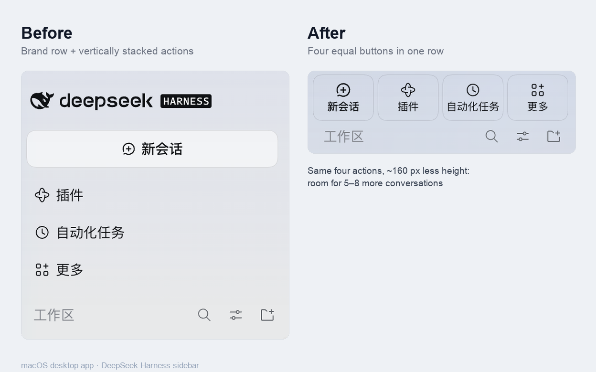
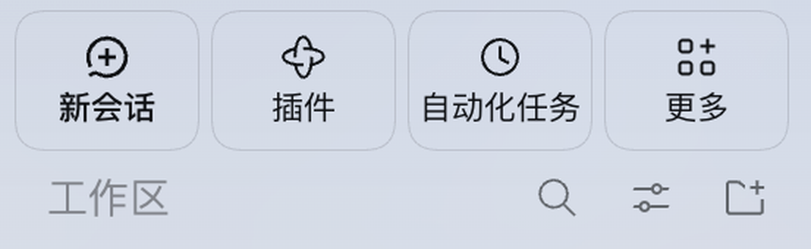

# dsh-sidebar-compact-macos

A small **macOS desktop** UI plugin for [DeepSeek Harness](https://github.com/deepseek-ai/deepseek-harness).
It keeps the sidebar's four existing actions, but puts them on one compact row and
removes the brand row, so the workspace and conversation list gets the vertical
space instead.





## What it changes

- **Drops the brand row** (`deepseek HARNESS`) from the expanded sidebar. The native
  window-chrome strip above it is kept, because it carries the sidebar collapse toggle.
- **One row of four equal, bordered buttons:** New session, Plugins, Scheduled tasks and
  More. Each keeps its original host element, handler, shortcut, selected state and menu —
  only the layout and the icon/label sizing are overridden.
- **Tightens the list:** the workspace section header goes from 36 px to 28 px, workspace
  rows from 34 px to 30 px, conversation rows from 32 px to 28 px, with smaller gaps
  between rows. Together with the header change the sidebar fits roughly 5–8 more
  conversations at a typical window height.

## Scope: macOS desktop only

This plugin only affects the **expanded sidebar of the macOS desktop app**, because it
relies on the desktop preload's `data-platform="darwin"` marker. A `dsh web` browser tab
and the Windows/Linux desktop layout are left completely untouched. That is intentional:
the selectors target the macOS window-chrome layout (the drag strip that owns the collapse
toggle).

## Compatibility

- Tested with DeepSeek Harness **0.2.2-rc.1**.
- `engines.dsh` is `>=0.2.2-rc.1 <0.3.0-0`.
- The overrides match the host's CSS-module class-name suffixes (`_logoRow`, `_panelRow`,
  `_sessionRow`, …) and scope themselves to the sidebar root. If a future host build
  renames those internals, the styles simply stop applying and the stock sidebar returns
  — the plugin fails safe rather than breaking the UI.
- It is a **CSS-only** client plugin: no network access, no analytics, no build step,
  no native code, no storage. `index.js` is an empty host half.

## Install

### Through the plugin market

Once listed in a market that carries the [awesome-dsh-plugin](https://github.com/awesome-dsh-plugin/awesome-dsh-plugin)
catalog, open **Plugins → Discover**, find **macOS compact sidebar** and install it.

### From this repository

Use the repository as a plugin bundle installation spec (the package declares
`dsh.bundle` and `cordis.patch.yml`, so it is installable from source; there is no build
step):

```text
dsh plugin add github:627666/dsh-sidebar-compact-macos
```

Then restart the app if the host asks for it.

## Uninstall

Remove the bundle from the profile through the plugin manager (or the market's installed
list). The injected `<style>` is removed with the plugin's effect cleanup, so the stock
sidebar comes back immediately.

## Screenshots

`screenshots.json` declares the two images above; both are crops of the real UI that do
not contain any conversation titles.

## License

MIT — see [LICENSE](LICENSE). This is an unofficial community plugin, not affiliated with
DeepSeek.
